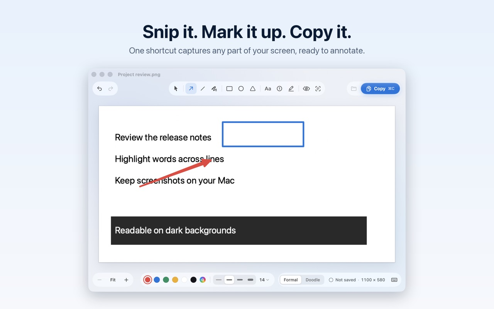

  

<h1 align="center">SnapApp: Snipping Tool for Mac</h1>

  Snip any part of your screen, mark it up with arrows, text and highlights, and copy it. 
  A free, native Mac app for people coming from the Windows Snipping Tool.

  <a href="https://apps.apple.com/app/snapapp-snipping-tool/id6817683799?mt=12">Mac App Store</a> ·
  <a href="https://github.com/founden-bot/snapapp/releases/latest">Direct download</a> ·
  <a href="https://snapapp.im/?utm_source=github&utm_medium=readme&utm_campaign=repo">Website</a>

## What it does

1. Press **Command + Shift + 2** (or record your own shortcut) and drag across what you want.
2. The snip opens straight in the editor: add arrows, lines, boxes, circles, text, a pen and highlights.
3. Press **Command + C** to copy the marked-up image and close, or drag it into a chat, an email or Finder.

Every snip is also saved as a full-resolution PNG in `Pictures/SnapApp`, named after the app you captured. SnapApp lives in the menu bar and needs no account.

## Coming from Windows

| On Windows | On a Mac, built in | In SnapApp |
| --- | --- | --- |
| Windows + Shift + S (Snipping Tool) | Shift + Command + 4, then drag | Command + Shift + 2, then drag |
| Mark up the snip | Click the floating thumbnail, then Markup | The editor opens by itself |
| Copy the snip | Add Control to the shortcut | Command + C in the editor |
| Snips folder | Desktop, unless you change it | Pictures/SnapApp, saved automatically |

More shortcuts: [every built-in Mac screenshot shortcut](https://snapapp.im/mac-screenshot-shortcuts?utm_source=github&utm_medium=readme&utm_campaign=repo).

## Free and Pro

Capturing, arrows, shapes, the pen, text and highlights are free for everyone, with no time limit and no watermark.

SnapApp Pro adds blur and pixelate, redaction, copying text out of a snip (text recognition on your Mac) and numbered steps: [plans and prices](https://snapapp.im/pricing?utm_source=github&utm_medium=readme&utm_campaign=repo). People who used SnapApp before Pro existed keep every Pro tool free.

## Download

- **Mac App Store:** [SnapApp: Snipping Tool](https://apps.apple.com/app/snapapp-snipping-tool/id6817683799?mt=12), updated through the App Store.
- **Direct download:** the ZIP on the [latest release](https://github.com/founden-bot/snapapp/releases/latest), signed with a Developer ID and notarized by Apple. Unzip it and move SnapApp into Applications. It checks for updates and installs them itself.

Requirements: macOS 14 Sonoma or later, Apple silicon or Intel. The interface speaks English, Czech, Danish, Dutch, Finnish, French, German, Hungarian, Italian, Japanese, Korean, Norwegian, Polish, Portuguese (Brazil and Portugal), Russian, Spanish, Swedish, Turkish and Ukrainian.

The first capture asks for Screen Recording permission: allow SnapApp in System Settings, Privacy & Security, Screen & System Audio Recording, and reopen it if macOS asks.

## Privacy

Capturing, marking up and text recognition happen on your Mac. Snips are never uploaded. The Mac App Store version makes no network requests at all.

## About this repository

This repository holds SnapApp's releases, checksums and release notes. SnapApp's source code is not published here. Questions and bug reports: [snapapp.im/support](https://snapapp.im/support?utm_source=github&utm_medium=readme&utm_campaign=repo), or open an issue.

SnapApp is made by O-mega Enterprise, Inc.
